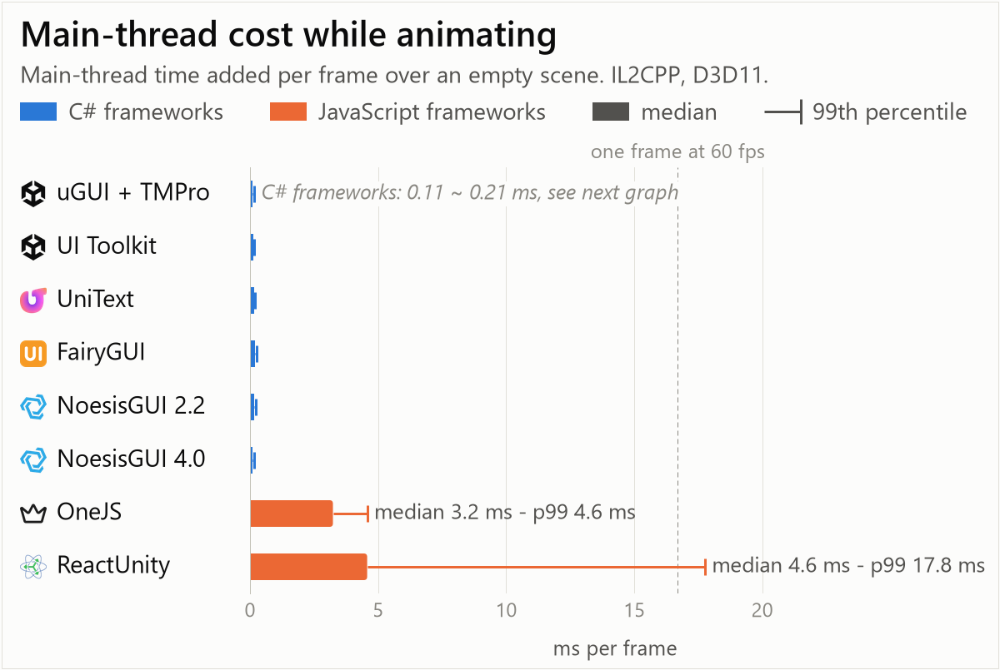
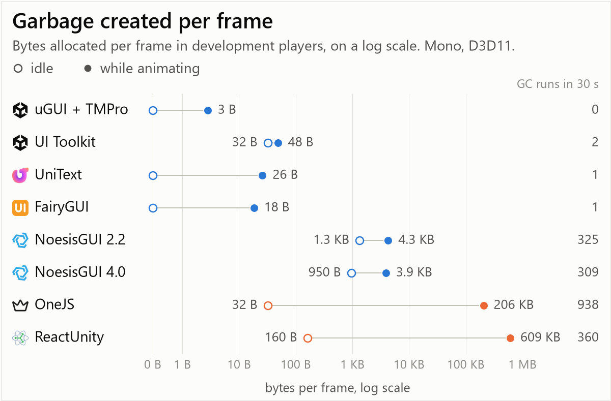
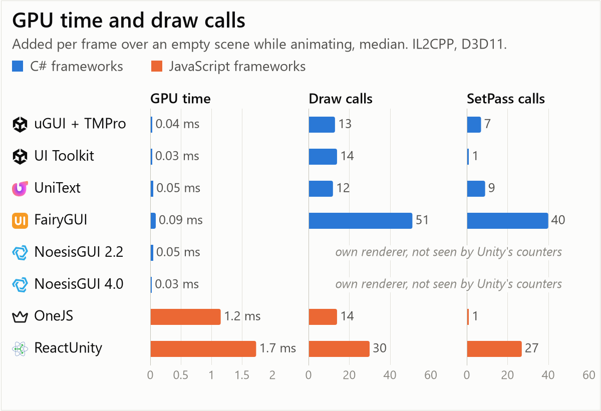
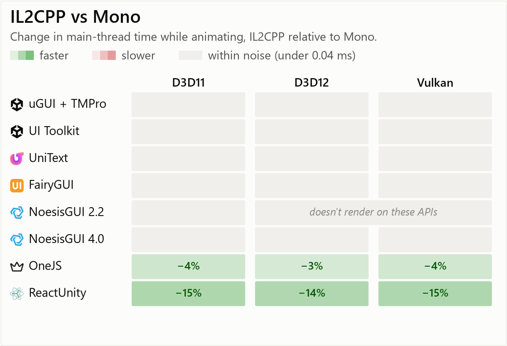
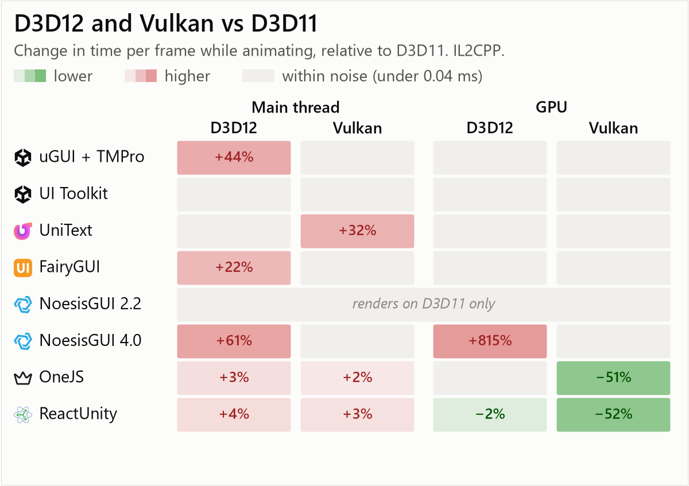
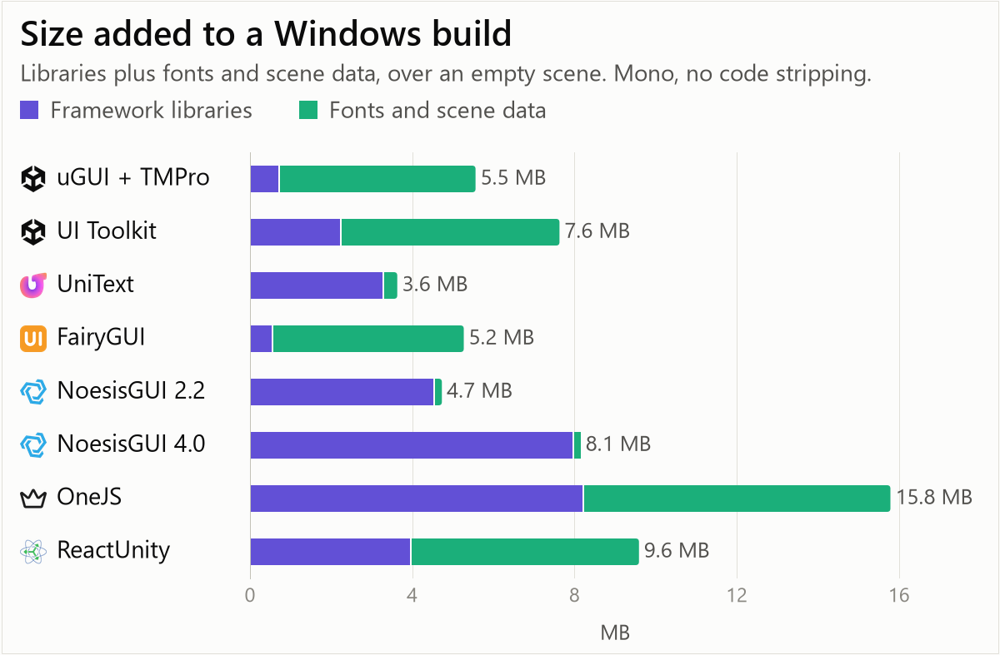
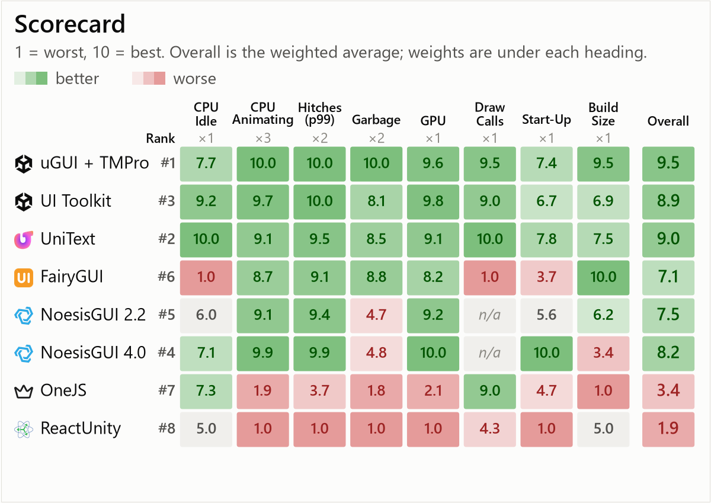

Few years ago, I made [Combo Counter](https://assetstore.unity.com/packages/tools/gui/combo-counter-system-217635), a unity asset which started out on uGUI. Over the last few months I ported its demo HUD to every UI framework I could use for free. Once I had all the demos working, it seemed a waste to not benchmark them: same HUD, same fonts, same C# component driving it, and only the UI framework changes which the HUD is set up in. You can see the HUD itself on the asset's store page.

Each framework has its own design workflow, and I won't get into that here. This post only looks at what each one costs at runtime in a packaged build.

**TL;DR**

- The six C# frameworks are all cheap, at 0.11 ~ 0.21 ms per frame, about 1% of a 60 fps frame.
- The two JavaScript frameworks cost 30 ~ 40 times as much, and every hit on ReactUnity costs about a whole 60 fps frame.
- NoesisGUI allocates garbage on every frame, even when nothing changes.
- IL2CPP helps the JavaScript frameworks and nobody else. Vulkan halves their GPU time.
- High code stripping saves about 15 MB, but four of the eight HUDs need a `link.xml` to survive it.
- Overall ranking: uGUI + TMPro, UniText and UI Toolkit at the top, the two JavaScript frameworks at the bottom.

## The Test

Each framework's scene is built into its own Windows build. A run warms up, sits idle with the HUD visible for 5 seconds, then animates combo hits for 30 seconds. That last phase is what the graphs call "while animating". Every number below is what the HUD adds on top of an empty scene with just the camera, so it shows the framework's cost, not Unity's. Each player ran 5 times on [Mono, IL2CPP] and on [D3D11, D3D12, Vulkan] and I use the median. Frame rate is uncapped. The machine is an i5-13600KF with an RTX 4070 Ti SUPER on Windows 11, running Unity 6000.4.12f1 with URP.

Building every player and running all 390 runs took around 4 hours 46 minutes overnight with no background applications on a debloated windows.

The frameworks:

- **uGUI + TMPro** (TextMesh Pro), built into Unity
- **UI Toolkit**, built into Unity
- **[UniText](https://github.com/LightSideKittens/UniText)** 1.0.0, the free version, renders through uGUI
- **[FairyGUI](https://github.com/fairygui/FairyGUI-unity)** 2026.2.3 from GitHub
- **[NoesisGUI 2.2](https://assetstore.unity.com/packages/tools/gui/noesisgui-2-2-9282)** 2.2.6 from the Asset Store
- **[NoesisGUI 4.0](https://www.noesisengine.com/developers/downloads.php)** 4.0.1, the free Indie package
- **[OneJS](https://github.com/Singtaa/OneJS)**, GitHub head from November 2026, renders through UI Toolkit
- **[ReactUnity](https://github.com/ReactUnity/core)**, GitHub head from November 2026, renders through uGUI

Unless a graph says otherwise, it shows an IL2CPP release build on D3D11, since that's what most Windows games ship with.

## CPU: The C# Frameworks Are Cheap, the JavaScript Ones Are Not

The JavaScript frameworks, out of the gate, cost drastically more. OneJS costs about 30 times what uGUI does, and ReactUnity about 40 times. ReactUnity runs at under 200 fps in this test, so about one frame in 19 has a hit in it, and its 99th percentile lands on those frames. Each hit costs ReactUnity about a full 60 fps frame, which you would see as a stutter. OneJS spreads its cost evenly across frames, so its hits barely stand out.

Up close, uGUI, UI Toolkit and NoesisGUI 4.0 are a three-way tie: the gaps between them are smaller than the run-to-run noise of the empty scene. UniText and NoesisGUI 2.2 cost about half as much again, and FairyGUI the most.

The idle dots are the interesting part. Every framework except FairyGUI is nearly free once the HUD stops changing, including both JavaScript frameworks. FairyGUI keeps doing most of its work whether or not anything changes.

## Garbage: NoesisGUI Allocates Every Frame

Allocations were measured in development players, the only builds where Unity reports them exactly, and on Mono, because IL2CPP development players add a flat 64 bytes per frame to every HUD scene.

uGUI, UniText and FairyGUI allocate nothing at all while idle. UI Toolkit allocates a little, and so does OneJS, which renders through it.

NoesisGUI is the surprise: it allocates on every frame, even idle, and the garbage collector runs hundreds of times in 30 seconds. That looks worse than it is, because the frame rate here is uncapped: at 60 fps, NoesisGUI 4.0 would create about 230 KB of garbage per second.

The JavaScript frameworks allocate in proportion to the work, not the frame rate: roughly 57 MB (OneJS) and 93 MB (ReactUnity) of garbage per second while animating.

## GPU and Draw Calls

On the GPU, the JavaScript frameworks are the outliers again. Among the C# frameworks, only FairyGUI stands out, and it also makes by far the most draw and SetPass calls for the same HUD. UI Toolkit batches best: OneJS, which renders through it, gets the same single SetPass call. NoesisGUI draws with its own renderer, so Unity's call counters don't see it at all.

## Does the Backend or the Graphics API Change Anything?

For the C# frameworks, Mono and IL2CPP are indistinguishable. Every difference is inside the noise, on every graphics API. IL2CPP only helps the JavaScript frameworks, and ReactUnity the most.

Switching from D3D11 costs a little CPU on most frameworks, though the changes are small in absolute terms. Two results stand out:

- **NoesisGUI 4.0 needs about nine times its D3D11 GPU time on D3D12, +815%.** If you ship NoesisGUI on D3D12, check your GPU timings.
- **Vulkan halves the GPU time of both JavaScript frameworks.**

NoesisGUI 2.2 can't be installed next to 4.0, so I measured it in a separate set of builds against its own empty scene. It renders on D3D11 only.

## Start-up Time and Build Size

Start-up time comes from the Mono players, because IL2CPP players don't report when the process started. ReactUnity is the only framework you'd notice, at about two thirds of a second, and it spends that time before its first frame, most likely starting its JavaScript engine. FairyGUI gets its first frame out as fast as the others, then takes a while longer before the HUD is ready.

The fonts weigh more than most frameworks do. FairyGUI and uGUI need less than a megabyte of libraries, while NoesisGUI 4.0 and OneJS need about eight. UniText and ReactUnity include uGUI, and OneJS includes UI Toolkit, because they render through them.

The graph uses the Mono build, where each framework's code sits in its own files. IL2CPP compiles everything into one `GameAssembly.dll`. There, the JavaScript frameworks add another 8 ~ 9 MB of generated code, and the C# frameworks about 1.6 MB each.

Building the IL2CPP players with High managed stripping instead of Minimal made every player about **15 MB smaller**, and runtime cost didn't change.

Out of the box, though, four of the eight HUDs broke, because they reach code through reflection that the linker can't see.

## Scorecard and Overall Ranking

To pull everything together, I scored each framework from 1 to 10 on every measurement above, using the same numbers as the graphs:

- **Scale:** the best framework on a measurement gets 10 and the worst gets 1, with the rest placed on a log scale between them, because the values span orders of magnitude.
- **Noise:** the 0.04 ms noise is added to every time before scoring. Without it, an idle time of 0.010 ms would score as three times better than 0.031 ms, when both are inside the noise.
- **Weights:** CPU time while animating counts three times, hitches and garbage twice, and everything else once, because frame time is what players feel first. With equal weights, the order is the same.
- **Missing values:** NoesisGUI's draw calls can't be measured, so they're left out of its average.

The overall ranking, from best to worst:

1. uGUI + TMPro, 9.5
2. UniText, 9.0
3. UI Toolkit, 8.9
4. NoesisGUI 4.0, 8.2
5. NoesisGUI 2.2, 7.5
6. FairyGUI, 7.1
7. OneJS, 3.4
8. ReactUnity, 1.9

uGUI wins on the measurements with the most weight: it has the lowest CPU time while animating and the least garbage. It loses ground on idle CPU time, where UniText and UI Toolkit do better, and on start-up, where NoesisGUI 4.0 is more than twice as fast. NoesisGUI 4.0 is held back by its garbage and its build size, and FairyGUI by its idle cost and draw calls. The top three are within 0.6 points of each other, so for a HUD like this any of them is a safe choice. The ranking only covers runtime cost, not workflow, and it reflects one small HUD written by someone who knows uGUI best.

## What I Take from It

The JavaScript frameworks are almost free until something changes, and expensive once it does. My guess is that the cost comes from pushing changes across the C#/JavaScript boundary and re-rendering, plus the garbage that creates. For a menu that changes when you click, that's fine, and what you get in return is a web-style workflow. For a HUD that animates every frame, they're the most expensive options here by a wide margin.

For a small HUD, choosing between uGUI, UI Toolkit and NoesisGUI 4.0 on performance is pointless. Choose on workflow.

Neither the backend nor the graphics API changes the ranking. These settings won't rescue a slow choice or ruin a fast one.

## Caveats and Help Wanted

- This is one small HUD: a counter, a handful of popups and some buttons. It says nothing about scroll lists, layout-heavy screens or thousands of elements.
- I wrote all eight integrations, and I know uGUI best. If you know one of these frameworks well and think I'm holding it wrong, tell me and I'll re-run it.
- The frame rate was uncapped, at thousands of frames per second for the C# frameworks, so anything allocated per frame looks worse than it would at 60 fps.
- It's one Windows machine. If you can run it on Linux, macOS or a weaker GPU, send me a message!

## Full Method

- **Phases:** each run is a 5-second warm-up with hits, 5 seconds idle with the HUD visible, then 30 seconds of exactly 10 hits per second. The window is 1920x1080 with vSync off and no frame-rate cap.
- **Matrix:** Mono and IL2CPP release players on D3D11, D3D12 and Vulkan, 5 runs each. Development players of both backends on D3D11 for allocations. IL2CPP players at High stripping, 3 runs. The order of the scenes rotates between runs.
- **Builds:** Mono with code stripping disabled, IL2CPP at Minimal (the lowest it allows) with the Release compiler configuration. Uncompressed StandaloneWindows64 players.
- **Measurements:** main-thread and GPU time come from Unity's FrameTimingManager, draw and SetPass calls from the render counters, and allocations from the "GC Allocated In Frame" counter.
- **Noise:** the empty scene's own main-thread time varied by up to about 0.03 ms between runs, so I treat any difference under 0.04 ms as noise.
- **NoesisGUI 2.2:** built as a separate set with its own empty scene and the same settings, on D3D11 only.
- **Machine:** i5-13600KF, 32 GB DDR4-3200, RTX 4070 Ti SUPER, Windows 11 26H2, Unity 6000.4.12f1 with URP.

Logos are trademarks of their owners and are used only to identify each framework.

Cheers!
