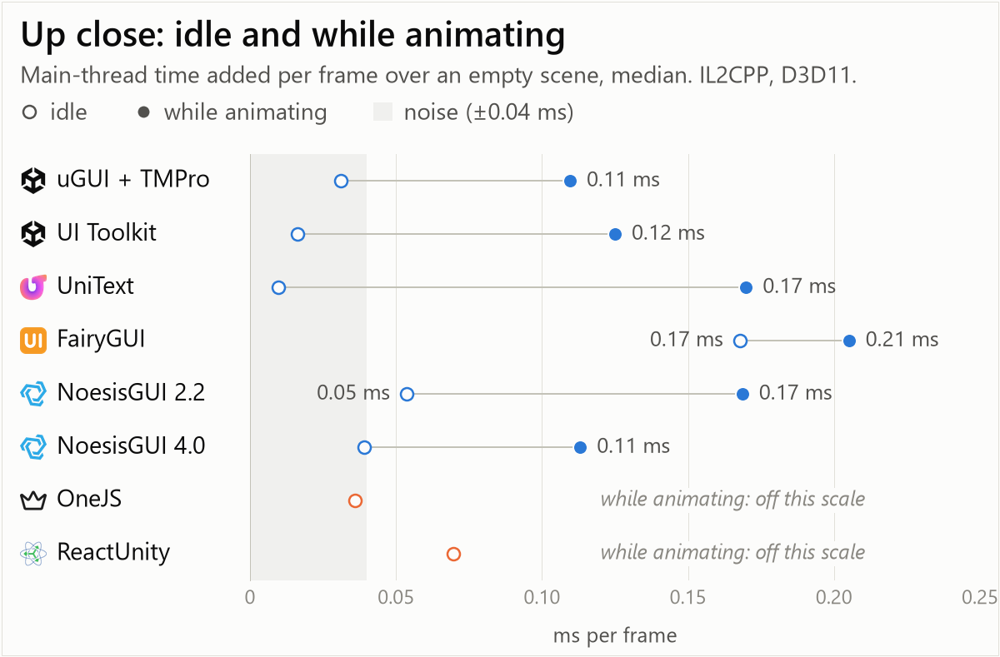
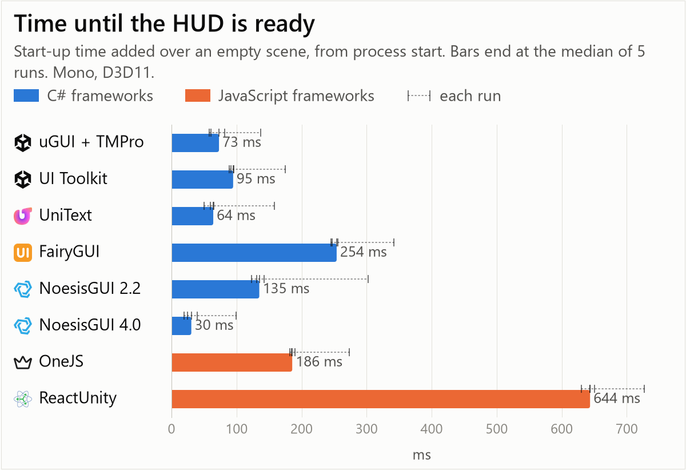

A few years ago, I made a simple combo-counter, player-feedback asset for unity using uGUI. Over the last few months, I've been updating [Combo Counter](https://assetstore.unity.com/packages/package/1830129) to work on Unity 6+ and I ported its demo HUD to UI toolkit seeing as to how it is maturing... but then I thought why the hell not and I rebuilt the same UI on every framework I could find for free. Once I had all the demos in a working state, it seemed a waste to not benchmark them. The same output, same fonts, same main C# system driving it, and only the UI framework changes behind the HUD.

// insert HUD Image

Each of these UI frameworks has its own design workflow, which I won't get into that here. This post is strictly about what each one costs at runtime in a packaged build since I *am* a nerd for optimizations after all.

**TL;DR**

- The 6 C# frameworks are all cheap, at 0.11 ~ 0.21 ms per frame while animating, about 1% of a 60 fps frame.
- The 2 JavaScript frameworks cost 30 ~ 40 times as much, and every hit on ReactUnity costs about a whole 60 fps frame.
- NoesisGUI allocates garbage on every frame, even when nothing changes.
- IL2CPP only helps the JS frameworks. Vulkan also halves their GPU time.
- High code stripping saves about 15 MB from all builds, but four of the eight HUDs need a `link.xml` to survive it.
- Overall ranking: The native unity frameworks uGUI & UI Toolkit come out at the top, & the 2 JS frameworks at the bottom.

## The Test

I made a separate build for each framework. A benchmark run warms up for 5 seconds, it sits idle with the HUD visible, then it animates combo hits for 30 seconds. Every number below is what the HUD adds on top of an empty scene with just the camera, so it shows the framework's cost, not the whole builds. Each player ran 5 times on [Mono, IL2CPP] and on [D3D11, D3D12, Vulkan] and I use the median. The frame rate is uncapped. Building every player and running all 390 runs took ~ 5 hours overnight with no background applications on a debloated windows.

The frameworks:

- **uGUI + TMPro** (TextMesh Pro), built into Unity
- **UI Toolkit**, built into Unity
- **[UniText](https://github.com/LightSideKittens/UniText)** 1.0.0, the free version, renders through uGUI
- **[FairyGUI](https://github.com/fairygui/FairyGUI-unity)** 2026.2.3 from GitHub
- **[NoesisGUI 2.2](https://assetstore.unity.com/packages/tools/gui/noesisgui-2-2-9282)** 2.2.6 from the Asset Store
- **[NoesisGUI 4.0](https://www.noesisengine.com/developers/downloads.php)** 4.0.1, the free Indie package
- **[OneJS](https://github.com/Singtaa/OneJS)**, GitHub head from November 2026, renders through UI Toolkit
- **[ReactUnity](https://github.com/ReactUnity/core)**, GitHub head from November 2026, renders through uGUI

System Specs: i5-13600KF | 32GB DDR4 | RTX 4070 Ti SUPER | Windows 11 26H2 | Unity 6000.4.12f1 | URP

Unless a graph says otherwise, it shows an IL2CPP release build on D3D11, since that's what most Windows games ship with.

## CPU: The C# Frameworks Are Cheap, the JavaScript Ones Are Not

The JavaScript frameworks, out of the gate, cost drastically more. OneJS costs about 30x what uGUI does, and ReactUnity about 40x. ReactUnity runs at under 200 fps while animating but at ~2700fps while idle, while an empty scene is ~3500fps and the C# frameworks run at ~2100fps - ~3300fps at idle and ~2000fps - ~2700fps while animating. Each hit costs ReactUnity about a full 60 fps frame, which you would see as a stutter. OneJS spreads its cost evenly across frames, so its hits barely stand out.

Up close, uGUI, UI Toolkit and NoesisGUI 4.0 are almost a 3-way tie, the gaps between them are smaller than the run-to-run noise of the empty scene. FairyGUI costs the most. The idle dots are the interesting part. Every framework except FairyGUI is nearly free once the HUD stops changing, including both JS frameworks. FairyGUI keeps doing work whether or not anything is changing in the scene.

## Garbage: NoesisGUI Allocates Every Frame

Allocations are measured in dev builds, the only builds where Unity actually reports them, and on Mono because IL2CPP dev builds add a flat 64 bytes per frame to every HUD scene.

uGUI, UniText and FairyGUI allocate nothing at all while idle. UI Toolkit allocates a little, and so does OneJS, which renders through it. NoesisGUI is the surprise: it allocates on every frame, even idle, and the garbage collector runs hundreds of times in 30 seconds. That looks worse than it actually is though, because the frame rate here is uncapped: at 60 fps, NoesisGUI 4.0 would create about 230 KB of garbage per second. The JS frameworks allocate in proportion to the work, not the frame rate: roughly 57 MB (OneJS) and 93 MB (ReactUnity) of garbage per second while animating.

## GPU and Draw Calls

On the GPU, the JS frameworks are the outliers again. Among the C# frameworks, only FairyGUI stands out, and it also makes by far the most Draw calls and SetPass calls. UI Toolkit batches best. OneJS, which renders through it, gets the same single SetPass call. NoesisGUI draws with its own renderer, so Unity's call counters don't see it at all.

## Does the Backend or the Graphics API Change Anything?

For the C# frameworks, Mono and IL2CPP are indistinguishable. Every difference is inside the noise, on every graphics API. IL2CPP only helps the JS frameworks & ReactUnity the most.

Switching from D3D11 to D3D12 or Vulkan costs a little CPU on most frameworks. Though the changes are small in absolute terms, two results stand out:

- **NoesisGUI 4.0 needs about nine times its D3D11 GPU time on D3D12, +815%.** If you ship NoesisGUI on D3D12, check your GPU timings.
- **Vulkan halves the GPU time of both JavaScript frameworks.**

## Start-up Time and Build Size

Start-up time comes from the Mono builds, because IL2CPP builds don't report when the process starts. ReactUnity is the only framework you'd notice a delay in the startup of at about 0.67s. It spends that time before its first frame, most likely starting its JS engine. FairyGUI gets its first frame out as fast as the others, then takes a while longer before the HUD is ready.

Each build only ships the fonts its own framework uses. TMPro and UI Toolkit bake the font into SDF atlases ahead of time, and the demo has 4 of them (one per combo tier, plus the buttons) at ~1.2MB each. So uGUI, UI Toolkit, FairyGUI, OneJS & ReactUnity all carry ~4.6MB of fonts. UniText and NoesisGUI ship the 57KB font file instead and rasterize the glyphs at runtime, which makes UniText the smallest build here at 3.6MB. For libraries, uGUI & FairyGUI need less than 1MB, while NoesisGUI 4.0 & OneJS need ~8MB. UniText and ReactUnity include uGUI, and OneJS includes UI Toolkit, because they render through them.

This graph also uses the Mono build, where each framework's code sits in its own files. IL2CPP compiles everything into one `GameAssembly.dll`. where the JS frameworks add another 8~9MB of generated code, and the C# frameworks ~1.6MB each.

Building the IL2CPP players with High managed stripping instead of Minimal made every player about **15 MB smaller**, and runtime cost didn't change. Though out of the box, 4 out of the 8 HUDs broke, because they reach code through reflection that the linker can't see.

## Scorecard and Overall Ranking

To pull everything together, I scored each framework from 1 to 10 on every metric above, using the same numbers as the graphs:

- **Scale:** the best framework on a metric gets 10 and the worst gets 1, with the rest placed on a log scale between them, because the values span orders of magnitude.
- **Noise:** the 0.04ms noise is added to every time before scoring. Without it, an idle time of 0.01ms would score as 3x better than 0.031 ms, when both are inside the noise.
- **Weights:** CPU time while animating counts 3 times, hitches and garbage twice, and everything else once, because frame time is what players feel first. With equal weights, the order is the same.
- **Missing values:** NoesisGUI's draw calls can't be measured, so they're left out of its average.

The overall ranking, from best to worst:

1. uGUI + TMPro, 9.5
2. UniText, 9.0
3. UI Toolkit, 8.9
4. NoesisGUI 4.0, 8.2
5. NoesisGUI 2.2, 7.5
6. FairyGUI, 7.1
7. OneJS, 3.4
8. ReactUnity, 1.9

**uGUI + TMPro wins!** It has the lowest CPU time while animating and the least garbage. It loses ground on idle CPU time, where UniText and UI Toolkit do better, on start-up, where NoesisGUI 4.0 is more than twice as fast, and on build size, where UniText's runtime fonts make it the smallest. NoesisGUI 4.0 is held back by its garbage and its libraries, and FairyGUI by its idle cost and draw calls. The top three are within ~0.5 points of each other, so for a HUD like this any of them is a safe choice. The ranking only covers runtime cost, not workflow, and it reflects one small HUD written by someone who knows uGUI best.

## What I Take from It

The JS frameworks are almost competitive until something starts animating. My guess is that the cost comes from pushing changes across the C#/JS boundary and re-rendering, plus the garbage that is created in the process. For a menu that changes when you click, that's fine, and what you get in return is a full Web Dev workflow. For a HUD that animates every frame, they're the most expensive options here by a wide margin.

For a small HUD, choosing between uGUI, UI Toolkit, UniText & NoesisGUI 4.0 on performance is pointless, choose the one that best fits your workflow. Neither the backend nor the graphics API change that ranking.

## Caveats and Help Wanted

- This is one small HUD: a counter, a handful of animating popups and some buttons. It says nothing about scroll lists, layout-heavy screens or thousands of elements.
- I wrote all eight integrations, and I know uGUI best. If you know one of these frameworks well and think I'm holding it wrong, tell me and I'll update it.
- The frame rate was uncapped, at thousands of frames per second for the C# frameworks, so anything allocated per frame looks worse than it would at 60 fps.
- It's one Windows machine. If you can run it on Linux, macOS or a different GPU, send me a message!

Logos are obviously trademarks of their owners and are used only to identify each framework only.

Have a good one. Cheers!